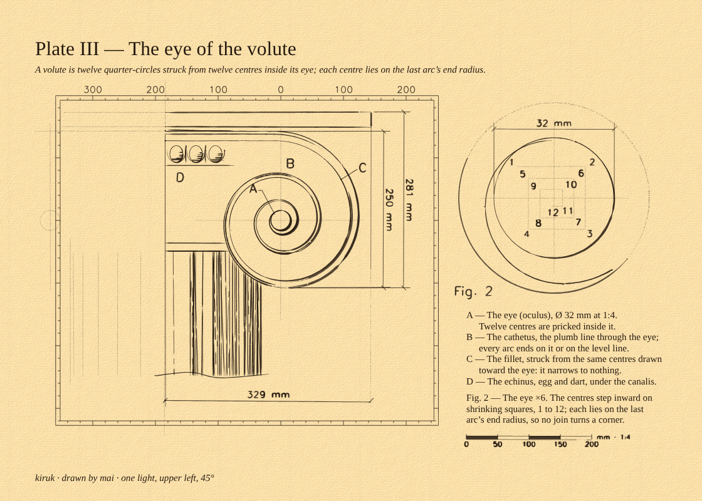

# Plate III — The eye of the volute

**Claim.** A volute is twelve quarter-circles struck from twelve centres inside its eye. Each centre lies on the last arc's end radius, so the scroll turns without a corner.

**Why this subject.** The founder shared a Corinthian column, Leonardo's eye studies and three construction sheets, and asked for an engine that handles historic design in every detail. Architecture already has an eye: the Ionic volute is struck from its oculus. This plate puts kiruk's motif inside a historic construction instead of on top of one.

## What is drawn

- **Fig. 1, the capital at 1:4, in two halves.**
  - **The right half is finished** in iron-gall on Dawn Light:
    - the abacus and its narrow cast shadow;
    - the canalis, running across the capital and winding into the scroll, shaded with lines that follow the channel;
    - the fillet, struck from the same centres pulled toward the eye, so it narrows to nothing;
    - the echinus with egg-and-dart;
    - the astragal, and a stub of the fluted shaft behind the scroll, hidden where the scroll stands in front, ending in a break line.
  - **The left half is construction only**, so the process shows: the axis, the mirrored eye and cathetus, the abacus, the canalis and the flutes.
- **Fig. 2, the eye at ×6.** The twelve centres are pricked and numbered in the order they are struck, on their shrinking squares, with the last arcs closing on the eye.
- **Measures, inside the figure:**
  - the volute height, **250 mm** at 1:4, measured from the drawn spiral;
  - the eye, **Ø 32 mm**, measured in Fig. 2 at its own scale;
  - a scale bar from 0 to 200 mm at 1:4.
- **Measures, outside the figure** (added after the founder's sphere and FIG. 3 references):
  - the capital's overall size from its ink, **329 mm** wide (from the axis to the scroll) and **281 mm** high (abacus to the foot of the scroll), each in the outer tier, one tier beyond the volute height;
  - the shaft is broken, so it is **not** dimensioned: a broken view is never measured to its break (ISO 129);
  - a **graduated neatline** round Fig. 1, a tick every 20 mm at 1:4 (numbered every 100 mm) counted from the eye of the volute, so the frame itself is the ruler.

## Truth (from `proof/report.json` and the plate's facts)

| Fact          | Value                                    | Source                                                              |
| ------------- | ---------------------------------------- | ------------------------------------------------------------------- |
| Volute height | 250 mm at 1:4                            | Measured from the drawn spiral                                      |
| Eye           | Ø 32 mm at 1:4                           | Eye radius 4 mm on the sheet                                        |
| Centres       | 12, steps 12:11:…:1 on shrinking squares | This plate's own construction                                       |
| Largest kink  | ≈ 0° at every join                       | Measured from the arcs (each centre lies on the last end radius)    |
| Capital       | 329 × 281 mm at 1:4                      | Measured from the capital's ink (`capital-bottom`, `capital-right`) |

**Not claimed.** These proportions are this plate's construction, not Vitruvius', Vignola's or Palladio's. The research files hold no treatise numbers for the volute, so none are quoted. A treatise construction can replace this one once its numbers are read from the source.

## Critic (2026-11-05)

`node packages/mai/scripts/proof.ts packages/mai/plates/volute.ts ideas/kiruk-codex/plates/plate-03-volute/proof --px 4 --commit`

The result is 72 checks, **0 fail, 1 warn, 1 look**. The full report is in [`proof/report.md`](proof/report.md); the parts table (anatomy) is at its end.

- **Anatomy:** 9 parts (abacus, scroll, canalis, eye A, cathetus B, fillet C, echinus D, shaft, Fig. 2), each drawn, finished as declared (line, tone or construction), keyed and noted where it has a key, and measured or given a reason it is not.
- **Outer measurement:** two overall dimensions, outermost on their sides and 8 mm beyond the inner tier (`measure.tiers-order`, `measure.tier-gap`); the neatline graduated at the plate's scale, with no ink across it.
- **WARN `type.phone`:** the plate is shown at 1.39 px/mm on a 390 px phone, so every label falls under 11 px. A landscape plate needs a phone layout (labels outside on leaders, or a crop per figure). This is open.
- **LOOK `create.founder`:** below.

Fixed on the way, recorded in `packages/mai/docs/ledger.md`:

- Round one: MA-5 (the canalis hatched as leaves, and the critic passed it), MA-6 (the shaft's joins read as bamboo), MA-8 (pens ran dry 2.5× too fast), MA-9 and MA-10 (the critic's own false fails).
- Round two: MA-16 (a fresh-dip blot filled the 4 of "345 mm"), MA-17 (the frame's 1.8 mm numbers read 4.2:1), MA-21 (the frame and a long shaft stub pulled the ink's weight to 54% of the height; the stub is now shorter), MA-22 (the overall dimensions first ran to the shaft's break line), MA-23 (the overall stood 2 mm from the volute height), MA-24 (the scale label's middle dot came out blank).

## Questions for the founder

1. Does the right-finished, left-constructed split read as the process, or as unfinished?
2. Should the eye of the volute become a studio mark study, next to the logogram?
3. Should plate notes stay in IM Fell (typeset, selectable), or be drawn by the hand (mai lettering, with a selectable twin)?
4. Phone: crop to the volute alone at phone widths, or keep the sheet and move the labels out?
