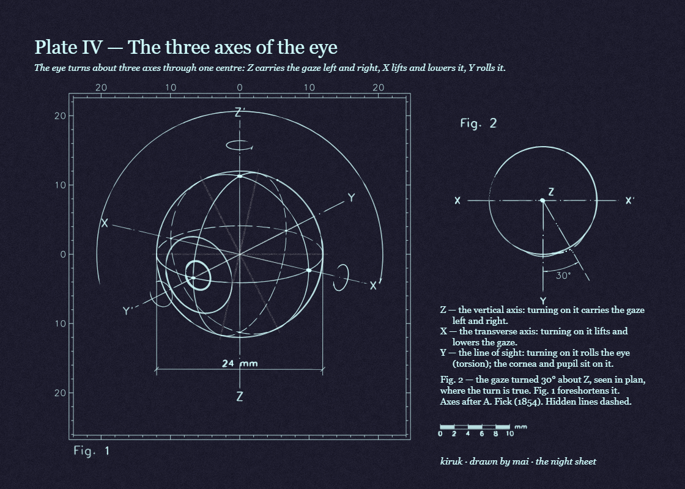

# Plate IV — The three axes of the eye

**Claim.** The eye turns about three axes through one centre. The vertical axis Z carries the gaze left and right, the transverse axis X lifts and lowers it, and the line of sight Y rolls it.

**Why this subject.** The founder shared a white-on-black sphere with its axes named at both ends (A–A′, B–B′, C–C′), hidden circles dashed, turn arrows on the axes and a wide sweep round the whole construction, and asked for care with "the outer measurement of the diagram". The studio's motif is the eye, and the eye is a sphere that turns on three axes. So the reference's construction is drawn on the eye itself, not on an empty ball.

## What is drawn

- **Fig. 1, the globe in axonometric view** (yaw −34°, pitch 20°), on the night sheet:
  - the outline, and three great circles (equator, sagittal, frontal); the half of each circle behind the globe is **dashed**, as ISO 128 draws a hidden edge;
  - three axes as **chain lines**, named at both ends where they leave the figure (Z–Z′, X–X′, Y–Y′), a dashed run where the globe hides them, a dot at each pole, and a **turn arrow** on each;
  - the cornea's rim and the pupil on the line of sight, which is what makes the ball an eye;
  - each great circle's ellipse **built in chalk on its major and minor axes**, recorded as the construction that generates it;
  - the **sweep**: a wide arc over the figure, as in the reference; its angle is not readable in this view, so it is measured in Fig. 2.
- **Fig. 2, the plan**, looking down Z, where the plane of the turn is true size: X–X′ as a chain line, the line of sight Y as a chain line, the gaze turned 30° about Z as a **phantom line** (ISO 128's line for another position of a part), the cornea's bulge on each, and the **angle of the turn, 30°**, measured from the rays.
- **Outer measurement** of Fig. 1:
  - the globe's diameter, **24 mm**, measured from the outline's ink and set in the outer tier;
  - a **graduated neatline**, a tick every 2 mm (numbered every 10 mm) at the plate's scale, counted from the centre of the globe, so any point of the figure can be read off the frame;
  - a scale bar, 0–10 mm.

## Truth (from the plate's facts and `proof/report.json`)

| Fact           | Value                                       | Source                                                         |
| -------------- | ------------------------------------------- | -------------------------------------------------------------- |
| Eye's diameter | 24 mm                                       | Adult eyeball ≈ 24 mm (standard anatomy texts, Gray's Anatomy) |
| Axes           | X transverse · Y line of sight · Z vertical | Fick's axes (A. Fick, 1854)                                    |
| Turn shown     | 30° about Z                                 | This plate's choice, drawn true in plan                        |
| Measured       | 24 mm (ink 23.99), 30° (rays 30.00°)        | `measure.true:globe-extent-bottom`, `measure.angle:gaze-turn`  |

**Not claimed.** The plate draws Fick's idealised model: one fixed centre of rotation, at the middle of the globe. A living eye's centre of rotation moves a little with the movement and sits slightly behind the middle. The plate does not claim otherwise, and it does not show the muscles that make the turns.

## Critic (2026-11-05)

`node packages/mai/scripts/proof.ts packages/mai/plates/axes.ts ideas/kiruk-codex/plates/plate-04-axes/proof --px 4 --commit`

The result is 55 checks, **0 fail, 1 warn, 1 look**. The full report is in [`proof/report.md`](proof/report.md); the parts table (anatomy) is at its end.

- **Line types:** 39 hidden strokes, all dashed (`line.hidden`); 10 dashed lines, the hand's dashes uneven as a hand's are (`line.dashes`); every long chain line named at an end (`connect.axes-named`).
- **Anatomy:** 8 parts (globe, cornea, planes, the three axes, sweep, plan), each drawn, finished as declared, keyed where it has a key, and measured or given a reason it is not.
- **WARN `type.phone`:** every label falls under 11 px on a 390 px phone. A landscape plate needs a phone layout; this is open, as on Plate III.
- **LOOK `create.founder`:** below.

## Questions for the founder

1. **The night sheet.** This plate uses a third paper, navy with departs-cyan ink, after the nightminds in `ideas/studio-dawn/dawn.md`. `eye.md` (open question 8) has not settled whether the studio has a night paper. Keep it, or redraw on Dawn Light?
2. Is chalk the right construction medium on the night sheet, or should construction stay in the ink at a lighter weight?
3. The sweep follows the reference (one wide arc round the whole figure). Should each axis keep its own small turn arrow as well, or is that one sign too many?
4. Phone: crop Fig. 1 alone at phone widths, or keep the sheet and move the labels out?
